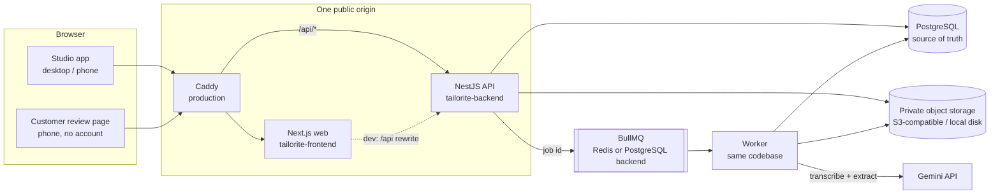

# Architecture

Tailorite is a web app (Next.js) in front of a NestJS modular monolith with a separately runnable worker that shares the same domain code. PostgreSQL is the source of truth for everything: data, sessions, rate limits, job state and the audit trail.

## Components

| Component | Where | Responsibility |
| --- | --- | --- |
| Web app | `tailorite-frontend/src/app` | Landing page, sign-up/onboarding, dashboard, customers, orders, brief workbench, order detail, version and print views, customer review portal, settings, demo entry. Renders only; all rules live in the API. |
| API | `tailorite-backend/src/main.ts` | Authentication, tenant scoping, validation, agreement state, approvals, change requests, money, file intake and serving, rate limits, audit. |
| Worker | `tailorite-backend/src/worker.ts` | BullMQ consumer for extraction jobs, 20 s recovery sweep (re-dispatch, lease expiry), 15 s heartbeat (shown in Settings), housekeeping, expiry of demo sandboxes. No HTTP server. |
| Contracts | `tailorite-backend/src/contracts` → copied to `tailorite-frontend/src/contracts` | Zod schemas, DTO types, labels and pure helpers (brief presentation, comparison, money formatting) shared by both sides. |

API modules (`src/`): `auth`, `studios`, `customers`, `orders`, `sources`, `briefs`, `approvals`, `portal`, `changes`, `payments`, `ai`, `jobs`, `audit`, `demo`, `health`, `storage`, plus `common` (Prisma, errors, CSRF, rate limits, logging) and `config` (validated environment).

## Main flows

1. **Intake.** The studio pastes messages or uploads images and voice notes (or records one). The API identifies files by content (magic bytes), enforces size/duration/count limits, stores originals privately under `studios/{studio}/orders/{order}/…`, and makes a metadata-free WebP preview for images.
2. **Extraction (optional).** Starting a run creates an `ExtractionJob` row (idempotency key, input fingerprint, draft revision) and sends only its id to the queue. The worker claims the job with a status-conditioned update and a lease, transcribes audio, asks Gemini for structured JSON, validates it against a Zod schema, checks that every quote really appears in the cited source of the same order, and stores suggestions and questions. It never edits the brief.
3. **Brief review.** The tailor accepts or edits suggestions, resolves conflicts and questions, and fills price and dates. Saves are revision-checked (`expectedRevision`) so two tabs cannot overwrite each other.
4. **Publication.** Readiness is checked on the server. A complete snapshot (customer-facing brief, references, terms, studio, change context) is frozen into a `BriefVersion` with a SHA-256 content hash, an `ApprovalRequest` and a hashed, expiring portal access.
5. **Customer decision.** The review page exchanges the link token for a short portal session and shows the snapshot. A decision locks the order row (`SELECT … FOR UPDATE`), checks the hash, closes the pending request with a status-conditioned update and writes exactly one `ApprovalEvent` (unique per request). Approval activates the version atomically.
6. **Changes.** After approval, a customer request (through a change-request link) or a studio proposal opens a `ChangeRequest`; the draft becomes a revision of the active version. Publishing it creates a revision version with a frozen before/after comparison. The active agreement and balance stay unchanged until the customer approves.
7. **Money and production.** Payments are manual ledger entries (corrections are reversals). Balances are computed from the active version. Production moves through an explicit state machine that only starts after approval.

## Request path and sessions

- Browser → `/api/*` on the web origin (Caddy in production, a Next.js rewrite in development) → API on :4000.
- Studio session: random token in an HttpOnly cookie (`__Host-tl_session` when served over HTTPS), only its hash stored in `Session`. Mutations require the `x-tailorite-csrf` header and a matching `Origin`/`Referer`.
- Customer session: HMAC-signed `tl_portal` cookie scoped to `/api/portal/{accessId}`, re-validated against the access row on every request.
